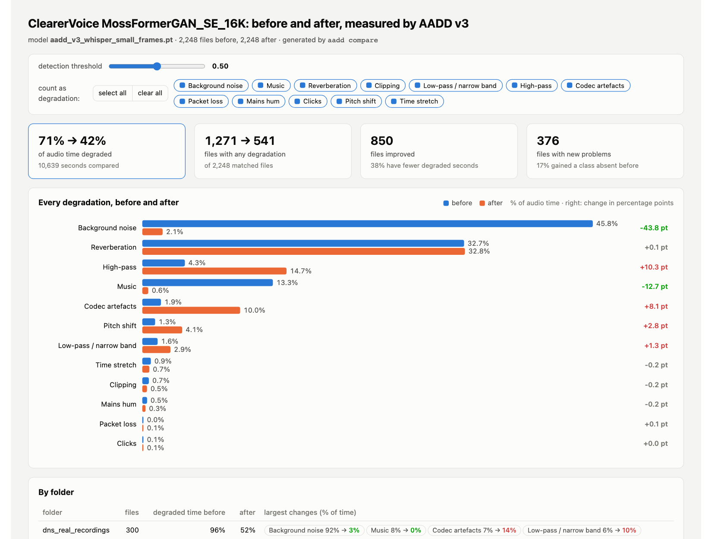
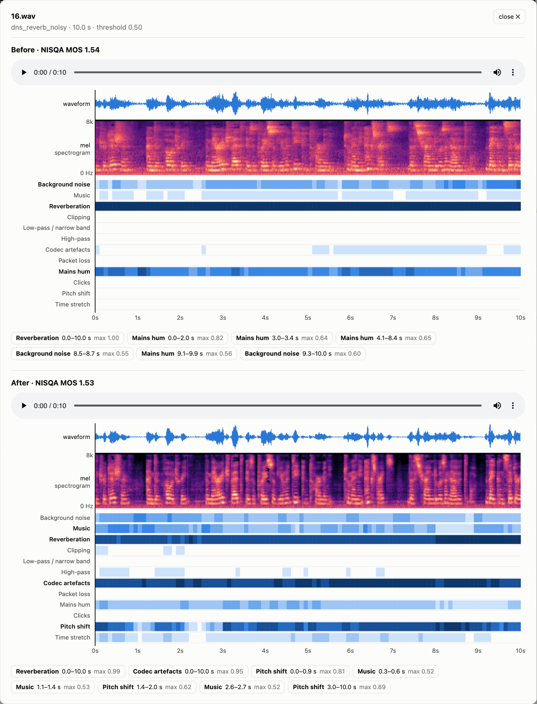

# AADD — Automatic Audio Degradation Detection

<p align="center">
  <a href="https://huggingface.co/agertel/aadd">
    <picture>
      <source media="(prefers-color-scheme: dark)" srcset="https://huggingface.co/datasets/huggingface/badges/resolve/main/model-on-hf-lg-dark.svg">
      
    </picture>
  </a>
</p>

[](https://github.com/gertelrina/aadd/actions/workflows/ci.yml)
[](LICENSE)
[](https://htmlpreview.github.io/?https://github.com/gertelrina/aadd/blob/main/docs/examples/report_public_sets.html)

**Contents:** [v3](#v3-what-it-builds-on) · [Dataset report](#dataset-report) · [Before / after](#before--after-did-the-cleaning-help) · [Install](#install) · [Models](#models) · [Usage](#usage) · [Results](#results) · [Reproducing](#reproducing--training-on-your-own-data) · [Limitations](#limitations) · [Layout](#repository-layout) · [Citation](#citation)  
**Docs:** [related work, 100 references](docs/related_work.md) · [model card](docs/model_card.md) · [v3 plan](docs/v3_plan.md)

<p align="center">
  <picture>
    <source media="(prefers-color-scheme: dark)" srcset="docs/img/demo_dark.gif">
    
  </picture>
</p>
<p align="center"><sub>This is the file view of the <a href="#dataset-report">dataset report</a>, recorded as is. The clip is held-out LibriSpeech speech with five degradations inserted at known times: noise 1.5–4.0 s, reverberation 5.0–7.5 s, clipping 8.5–10.0 s, MP3 at 8 kbit/s 10.5–12.5 s, clicks 11.0–13.5 s. v3 finds all five.</sub></p>

AADD finds **which degradation is present in speech, and where, every 20 ms**:
background noise, music, reverberation, clipping, low-pass / narrow band,
high-pass, codec artefacts, packet loss, mains hum, clicks, pitch shift and time
stretch, several at once, in English and Russian. Point it at a file or a whole
dataset and get per-file verdicts, a timeline down to 20 ms and an interactive HTML
report with how much clean audio you keep at any threshold — a quality gate for
ASR / TTS training data, call-centre and podcast pipelines, and a way to check
what a speech enhancer really did.

> [!TIP]
> **Demo — interactive dataset report.** 2 248 public recordings (VoiceBank-DEMAND, DNS Challenge 2020) scanned by v3.1.
> Move the threshold and see how much clean audio you keep, switch classes off, rank files worst- or best-first,
> **listen to any file** with its spectrogram and 100-ms class timeline, and download the list of clean files.
>
> **[▶ Open the interactive report](https://htmlpreview.github.io/?https://github.com/gertelrina/aadd/blob/main/docs/examples/report_public_sets.html)** · [before / after speech enhancement](https://htmlpreview.github.io/?https://github.com/gertelrina/aadd/blob/main/docs/examples/compare_clearervoice.html) with [ClearerVoice-Studio](https://github.com/modelscope/ClearerVoice-Studio) · make your own: `aadd scan my_dataset/ --report report.html`

## v3: what it builds on

The closest research already shows how to find *which* degradation is in a
recording and *where*: Amazon's per-second artefact classifier (Higham et al.,
2022), per-degradation CNN detectors (Saishu et al., 2021), frame-level localisers
of partial distortions (DAMOS and Speech Quality Embeddings, 2026). But none of
these papers released code or weights, and each covers only part of the problem:
a few classes, one language, utterance-level labels or no realistic data. In
practice people fall back on a single MOS score from NISQA or DNSMOS, which says
*how bad* a recording is, never *what* is wrong or *where*.

v3 takes the strongest idea from each of these works and puts them into one open
model under MIT: 12 realistic degradation classes, labels every 20 ms, several
degradations at once, English and Russian, built only from openly licensed data
and weights, with the code, the data generator and the weights published.

<details><summary>The nine works v3 combines, and what it takes from each</summary>

| work | what v3 takes from it | why it matters |
|---|---|---|
| [URGENT Challenge](https://arxiv.org/abs/2406.04660) (Zhang et al., 2024–2026) | the degradation taxonomy: noise, reverberation, clipping, band limitation, codecs, packet loss | an agreed, realistic class list used by the speech-enhancement community, instead of augmentation-library defaults |
| [Audio Degradation Toolbox](https://archives.ismir.net/ismir2013/paper/000145.pdf) (Mauch & Ewert, ISMIR 2013) | chainable degradation units in a fixed signal-chain order; hum and click generators | reproducible compound degradations with exact ground truth |
| [DAMOS](https://arxiv.org/abs/2608.21176) (Li, Dong, Yan, 2026) | partial distortions inserted into random segments of LibriSpeech with frame-level labels | the model learns *where*, not just *whether*; no seams at fixed 1-s boundaries |
| [Speech Quality Embeddings](https://arxiv.org/abs/2605.21332) (Kuhlmann et al., Odyssey 2026) | simultaneous degradations in one clip; frame-level evaluation | real recordings rarely have exactly one problem |
| [Higham et al.](https://openaccess.thecvf.com/content/WACV2022W/VAQ/papers/Higham_A_No-Reference_Model_for_Detecting_Audio_Artifacts_Using_Pretrained_Audio_WACVW_2022_paper.pdf) (Amazon, WACV-W 2022) | a pretrained audio backbone instead of an ImageNet CNN; hum and click classes; per-second reporting | audio pre-training transfers far better to artefact detection |
| [Saishu et al.](https://link.springer.com/article/10.1186/s13636-021-00198-4) (EURASIP 2021) | one independent detector (sigmoid) per degradation type | handles co-occurring and unseen combinations, unlike a softmax |
| [WhiSQA](https://arxiv.org/abs/2508.02210) (Close et al., 2025), [UTMOSv2](https://arxiv.org/abs/2409.09305) (Baba et al., SLT 2024) | a speech foundation encoder (Whisper) as the backbone | Whisper was trained on noisy, multilingual real-world audio and is Apache-2.0 licensed |
| [Tamm et al.](https://arxiv.org/abs/2308.12077) (WASPAA 2023) | a learnable weighted sum of **all** encoder layers | noise and room cues live in early layers, which the last layer discards |
| [Hook-Net](https://arxiv.org/abs/2202.05718) (Wolff et al., ISMIR 2021) | frame-level outputs and masking frames where a defect is physically absent | clicks and clipping are sparse; per-chunk labels would be mostly wrong |

Data and models used, all openly licensed: LibriSpeech and Russian LibriSpeech
(speech), MUSAN (noise, music), RIRS_NOISES and the MIT IR survey (room impulse
responses), Whisper-small (backbone); VoiceBank-DEMAND, DNS Challenge 2020 and
Dynamic-SUPERB for out-of-domain evaluation. Details and licences:
[docs/v3_plan.md](docs/v3_plan.md); the wider literature: [docs/related_work.md](docs/related_work.md).

</details>

## Dataset report

<details><summary>What the interactive report shows, the example in numbers, and the file view</summary>

`aadd scan DIR --report report.html` (or `aadd report scan.json`) writes one
self-contained, **interactive** HTML page for the whole dataset. Move the
detection threshold, set how many degraded seconds a file may have and still be
kept, switch classes on or off ("ignore music", or select / clear all at once), and every number updates live:
how much clean audio is left, which degradations dominate, how degraded each file
is, which problems come together, each folder, a file table ranked worst-first or best-first with a
timeline strip per file. Click any file to **listen to it** with a waveform and a 100 ms class timeline that follows playback (click the timeline or a detected interval to jump there). One click exports the list of kept files as CSV. Light and dark themes,
no external assets.

The [demo](https://htmlpreview.github.io/?https://github.com/gertelrina/aadd/blob/main/docs/examples/report_public_sets.html) is this page for v3.1 on 2 248 public recordings it never saw:
VoiceBank-DEMAND clean and noisy twins and the DNS Challenge 2020 dev-test. Below is the file view.

<picture>
  <source media="(prefers-color-scheme: dark)" srcset="docs/img/report_inspector_dark.png">
  
</picture>

The example page embeds audio for the most degraded files and a few clean ones per
folder (`--audio embed`); a report built next to your data plays every file from
disk (`--audio path`, the default).

| folder | files flagged | dominant detection (% of audio time) |
|---|---|---|
| `voicebank_clean` (studio speech) | 0 % | — |
| `voicebank_noisy` (same sentences + DEMAND noise) | 80 % | background noise 59 %, music 26 % (mostly the DEMAND living-room noise, which contains sustained tones) |
| `dns_reverb_clean` (reverberant speech) | 100 % | reverberation 100 % |
| `dns_reverb_noisy` | 100 % | reverberation 100 %, noise 86 % |
| `dns_real_recordings` (real noisy calls) | 98 % | background noise 93 % |

```bash
aadd scan my_dataset/ --model v3 --report my_dataset_report.html   # v3 weights are fetched from Hugging Face once
```

</details>

## Before / after: did the cleaning help?

Example with the open speech-enhancement toolkit [ClearerVoice-Studio](https://github.com/modelscope/ClearerVoice-Studio) (Alibaba Tongyi Lab, Apache-2.0).

<details><summary>Speech enhancement measured with AADD: <a href="https://github.com/modelscope/ClearerVoice-Studio">ClearerVoice-Studio</a> on 1 096 noisy files</summary>

`aadd compare before.json after.json` puts two scans of the same files side by
side: every class before and after, each folder, the files that improved most,
the files that gained new problems, and both versions of a file with their own
player, spectrogram and timeline.

Example: the 2 248 public recordings from the [dataset report](#dataset-report).
v3.1 flagged background noise or music in 1 096 of them; only those were enhanced
with [ClearerVoice-Studio](https://github.com/modelscope/ClearerVoice-Studio)
(MossFormerGAN_SE_16K, Apache-2.0), then all files were scanned again with v3.1.
[Open the interactive comparison](https://htmlpreview.github.io/?https://github.com/gertelrina/aadd/blob/main/docs/examples/compare_clearervoice.html).

<picture>
  <source media="(prefers-color-scheme: dark)" srcset="docs/img/compare_dark.png">
  
</picture>

| enhanced files | degraded time | what changed |
|---|---|---|
| VoiceBank + DEMAND noise (658) | 97 % → 1 % | noise 73 % → 0 %, music-like noise 32 % → 0 % |
| DNS real recordings (286) | 98 % → 61 % | noise 96 % → 3 %, but codec artefacts 9 % → 16 %, reverberation 22 % → 29 % |
| DNS reverberant + noise (148) | 100 % → 100 % | noise 87 % → 17 %, reverberation unchanged, codec artefacts 1 % → 25 %, pitch-shift-like 3 % → 17 % |
| whole set (2 248 files) | 71 % → 44 % | files with any degradation 1 254 → 539 |

The enhancer removes noise very well but does not remove reverberation, and on
reverberant speech it adds codec-like and pitch artefacts — the kind of side
effect a single MOS number hides. In an earlier run that also enhanced the 150
reverberant-only DNS files, high-pass artefacts rose from 10 % to 92 % of their
time and pitch-shift-like artefacts from 1 % to 28 %, so reverberant files are
best left alone or sent to a dereverberation model. The recommended loop:

```bash
aadd scan raw/ --model v3 --json before.json
python scripts/enhance_with_clearervoice.py before.json raw/ enhanced/ --classes noise,music
aadd scan enhanced/ --model v3 --json after.json
aadd compare before.json after.json -o compare.html --audio embed
```

<details><summary>Both versions of a reverberant, noisy file, before and after enhancement</summary>

<picture>
  <source media="(prefers-color-scheme: dark)" srcset="docs/img/compare_pair_dark.png">
  
</picture>

</details>

</details>

## Install

```bash
pip install "aadd @ git+https://github.com/gertelrina/aadd"
# or, for development / training:
git clone https://github.com/gertelrina/aadd && cd aadd
pip install -e ".[all]"
```

Requirements: Python ≥ 3.10, PyTorch ≥ 2.1 (CPU is fine; CUDA and Apple MPS
are picked up automatically), `libsndfile` for FLAC/WAV.
Model weights are hosted on Hugging Face ([agertel/aadd](https://huggingface.co/agertel/aadd)) and downloaded once to `~/.cache/aadd` on first use (v1/v2 16 MB, v3 177 MB); set `AADD_CACHE` to change the folder.

## Models

**v3.1 is the current model and the default** (`--model v3`, `Detector()`): a
Whisper-small encoder that predicts 12 degradation classes every 20 ms, several at
once, in English and Russian. Its weights live on [Hugging Face](https://huggingface.co/agertel/aadd)
and are downloaded to `~/.cache/aadd` on first use. The earlier models stay
available: `v3.0` (first v3 release), and `v2` / `v1`, which predict seven synthetic
degradations once per second.

```
$ aadd scan examples/speech/61-70968-0000_4.flac examples/degradations/orig.flac --model v3
examples/speech/61-70968-0000_4.flac   4.0s   4/4 degraded s   clipping 1.00, highpass 1.00, hum 1.00
examples/degradations/orig.flac        2.4s   3/3 degraded s   codec 0.99, lowpass 0.95, time_stretch 0.59
```

| | v1 | v2 | **v3.1** |
|---|---|---|---|
| real background noise detected (ROC-AUC, VoiceBank-DEMAND) | 0.13 | 0.53 | **0.99** |
| studio-clean files wrongly flagged (any class, p ≥ 0.5)³ | 88% | 90% | **0%** |
| degradation classes · time resolution | 7 · 1 s | 7 · 1 s | **12 · 20 ms** |
| time per second of audio, CPU / Apple GPU² | 133 / 14 ms | 39 / **3** ms | **23** / 6.5 ms |

² Measured on an Apple MacBook Pro M3 Pro (36 GB), PyTorch 2.15, one process, end to end; details in [Results](#results) and [runs/README.md](runs/README.md).

³ A file counts as flagged if, for some class, the 95th percentile of its probabilities over time is at least 0.5 (the default threshold), so short isolated spikes do not count.

<details><summary>Architecture and inputs of every model</summary>

| name | input features | backbone | params | feature time / s of audio | notes |
|---|---|---|---|---|---|
| `v1` | mel spectrogram **rendered to a 310×385 PNG with matplotlib** (magma colormap, axes off) | EfficientNet-B0 (ImageNet init), 8 sigmoid outputs | 4.0 M | ≈ 9 ms | the first model (2025-03-11), unchanged weights |
| `v2` | log-mel tensor 1×128×63 (n_fft 1024, hop 256, top_db 80) | EfficientNet-B0 (ImageNet init, 1-channel stem), 8 sigmoid outputs | 4.0 M | ≈ 1 ms | same data protocol, no image rendering, SpecAugment-style masking |
| `v3.1` / `v3.0` | Whisper log-mel 80 × 800 (8-s windows, sliding) | Whisper-small encoder, weighted sum of all layers, conv head, 12 sigmoids per 20 ms | 88 M | GPU / Apple MPS recommended | realistic degradations, English + Russian; [weights on Hugging Face](https://huggingface.co/agertel/aadd), downloaded on first use |

v1 and v2 predict, for every 1-s chunk, the probability of each of
`AddGaussianNoise, PitchShift, TimeStretch, Shift, ClippingDistortion,
LowPassFilter, HighPassFilter, None`. The v1 pipeline rendered spectrograms
through `matplotlib` → PNG → RGB; `aadd.features.render_mel_png` reproduces it
pixel-for-pixel (tested), so `v1` keeps producing exactly its original outputs.
`v2` drops the rendering step. v3.1 is v3.0 fine-tuned with real environmental
noise and crowd babble (fewer false "music" detections on real background noise).

</details>

## Usage

### Command line

```bash
aadd scan audio_dir/ -o files.csv --segments segments.csv           # per-file CSV + timeline CSV (1-s segments)
aadd scan audio_dir/ --segments segments.csv --resolution 0.1       # timeline in 100-ms segments
aadd scan audio_dir/ --report report.html                           # interactive HTML dashboard (see Dataset report)
aadd scan a.flac b.wav --json out.json --threshold 0.7              # files -> JSON, incl. the 100-ms frame timeline
aadd scan big_dir/ --model v2 --workers 8                           # earlier per-second model, parallel feature extraction
aadd info                                                           # models, cache, device
```

**What the outputs contain** (v3.1 predicts every 20 ms; the files summarise that):

* **`files.csv`**, one row per file:
  * `status`: clean / degraded / error;
  * `degraded_segments` and `degraded_fraction`: how many segments, and what share of them, have any degradation;
  * `aadd_count`: number of detected (segment, class) pairs;
  * `detected`: the classes found in the file;
  * `p_<class>`: the highest probability of each class anywhere in the file.
* **`segments.csv`**, one row per segment of `--resolution` seconds (1 s by default, down to
  0.02 s), with the highest probability of every class inside that segment.
* **`--json`**: everything above plus a 100-ms timeline for every file.
* **`--report`**: the interactive HTML dashboard (see [Dataset report](#dataset-report)).
* **Input:** any format `libsndfile` / `ffmpeg` can read; audio is resampled to 16 kHz mono.

<details><summary><b>Python API</b></summary>

```python
from aadd import Detector

det = Detector()                           # v3.1 by default; "v2" / "v1" or a checkpoint path
res = det.predict_file("call.wav")
res.detected                               # {'AddGaussianNoise': 0.98}
res.probs                                  # (n_seconds, 8) sigmoid probabilities
res.segment_labels()                       # [['AddGaussianNoise'], [], ...]
res.degradation_count, res.degraded_fraction

for r in det.scan(["a.flac", "b.flac"], workers=4):   # many files, parallel features
    print(r.file_row())
```

</details>

<details><summary><b>Docker</b></summary>

```bash
docker build -t aadd .
docker run -v /path/to/audio:/data aadd scan /data --model v3 --report /data/report.html
```

</details>

## Results

<details><summary>All models compared; v3.1 on real recordings and held-out tests; v1 and v2 on their synthetic test</summary>

### All models at a glance

| model | detects | time resolution | **real recordings**: noise ROC-AUC (VoiceBank-DEMAND / DNS-2020 / Dynamic-SUPERB) | false alarms on studio-clean speech (VoiceBank clean): files with any class at p ≥ 0.5³ | synthetic test of v1/v2, mean over the 6 shared classes: ROC-AUC / F1 | ms per second of audio, CPU / Apple GPU (MPS)¹ |
|---|---|---|---|---|---|---|
| `v1` (2025) | 7 synthetic classes | 1 s | 0.13 / 0.64 / 0.52 | 88% | **0.995** / **0.954** | 133 / 14.4 |
| `v2` | 7 synthetic classes | 1 s | 0.53 / 0.82 / 0.73 | 90% | 0.994 / 0.948 | 39 / **3.1** |
| **`v3.1`** (default `v3`) | 12 realistic classes, overlapping, English + Russian | **20 ms** | **0.99 / 1.00 / 0.99** | **0%** | 0.976 / 0.675 | **23** / 6.5 |

**How to read it**

* **v1 and v2 work only on their own synthetic data.** On the test they were trained
  for they are near-perfect, but on real recordings real background noise is barely
  ranked above clean speech, and most studio-clean files are flagged.
* **v3.1 works on real recordings.** It ranks real noise almost perfectly and flags
  no studio-clean file.
* **On the v1/v2 synthetic test, v3.1 ranks every shared class well (ROC-AUC ≥ 0.95)
  but has a lower F1**, for two reasons:
  * that test uses extreme settings v3 never saw (low-pass 150–750 Hz, high-pass 2–8 kHz);
  * v3 also reports the low-level noise already present in the LibriVox source
    recordings, which the test labels as clean (noise recall 1.00, precision 0.32).
* **How the real-recording scores are computed:** v1 and v2 use their Gaussian-noise
  output; for every model the clip score is the 95th percentile of its
  probabilities over time.

Details: [runs/cross_eval.json](runs/cross_eval.json), [runs/eval_v3_1.json](runs/eval_v3_1.json).

¹ Apple MacBook Pro M3 Pro (6+6 CPU cores, 18-core GPU, 36 GB), macOS 15.7, PyTorch 2.15, one process, end to end on the same 300 LibriSpeech files (2 106 s); full table in [runs/README.md](runs/README.md#speed-v1-v2-and-v31-on-the-same-300-files).

³ A file counts as flagged if, for some class, the 95th percentile of its probabilities over time is at least 0.5 (the default threshold), so short isolated spikes do not count.

### v3.1 (Hugging Face: [agertel/aadd](https://huggingface.co/agertel/aadd))

Real recordings it never saw in training (clip score = 95th percentile of frame
probabilities):

| set | class | ROC-AUC | recall at p ≥ 0.5 | false alarms on clean files, same class at p ≥ 0.5 | music detections at p ≥ 0.5 (no music present) |
|---|---|---|---|---|---|
| VoiceBank-DEMAND test, 824 noisy vs 824 clean twins | noise | 0.992 | 0.60 | 0.0 % | 13.9 % of clips (v3.0: 21.1 %) |
| DNS Challenge 2020 synthetic dev-test, 600 clips | noise | 0.998 | 0.91 | 0.0 % | 8.2 % (v3.0: 11.3 %) |
| DNS Challenge 2020 synthetic dev-test, 600 clips | reverberation | 1.000 | 1.00 | 0.0 % | — |
| Dynamic-SUPERB noise detection (VCTK + MUSAN) | noise | 0.992 | 0.96 | 2.2 % | 0.5 % |
| Dynamic-SUPERB reverberation, small / medium / large room | reverberation | 0.994 / 1.000 / 0.996 | 0.98 / 1.00 / 0.97 | 0 % | 0–1.5 % |

**What changed in v3.1** (2026-11-06)

* **What it is:** v3.0 fine-tuned with real environmental noise (FSD50K, CC0 / CC BY
  clips only) and synthetic crowd babble added to the noise class.
* **Why:** v3.0 called real background babble in cafés, streets and buses "music".
* **Effect on VoiceBank-DEMAND**, share of noisy clips with a "music" detection, by noise type:
  * café: 41 % → 16 %
  * public square: 49 % → 25 %
  * bus: 39 % → 18 %
* **Side effect:** noise is detected more often (recall 0.51 → 0.60 on VoiceBank-DEMAND).
* **Which to use:** `--model v3` loads v3.1; `--model v3.0` loads the first release.

Held-out synthetic tests with up to three overlapping degradations (all 12 classes):

| test set | frame macro-AP (20 ms) | 1-s macro-F1 | clip macro-AUC |
|---|---|---|---|
| English (LibriSpeech test-clean), 3 000 × 8 s | 0.955 | 0.905 | 0.989 |
| Russian (Russian LibriSpeech test), 3 000 × 8 s | 0.960 | 0.881 | 0.987 |
| English, real measured RIRs | 0.954 | 0.902 | 0.991 |
| English, MIT IR survey RIRs | 0.946 | 0.883 | 0.990 |

v3 also catches what the earlier models were never trained to see: the
repository's own "clean" reference clip `examples/degradations/orig.flac` turns out
to be a narrow-band phone recording (no energy above 4 kHz; v3: low-pass 1.00,
codec 0.93), and LibriSpeech utterance `61-70968-0000` carries 60 Hz mains hum
(v3: hum 1.00). Full report: [runs/eval_v3.json](runs/eval_v3.json); per-class
numbers and limitations: [model card](https://huggingface.co/agertel/aadd).

### v1 and v2 (7 synthetic classes, 1-s chunks)

Evaluation on the regenerated test set (LibriSpeech **test-clean**, 2 620
source files × (1 clean + 5 degraded copies) = 15 720 files, 108 936 seconds,
41.6 % of them degraded; per-second labels; threshold 0.5). Reports with all
numbers are in [`runs/`](runs/).

### Models at a glance

| model | input | F1 macro (8 classes) | F1 macro (7 degradations) | F1 micro | exact match per second | file-level Spearman | ms per audio second, CPU / MPS |
|---|---|---|---|---|---|---|---|
| `v1` (2025) | PNG 310×385 | 0.831 | 0.818 | 0.908 | 0.906 | 0.932 | 133 / 14.4 |
| `v2` | log-mel 1×128×63 | **0.919** | **0.916** | **0.930** | **0.927** | **0.938** | 39 / 3.1 |

Per-class F1, ROC-AUC, file-level numbers, the v2 confusion matrix, the speed table and notes on reading these numbers: [runs/README.md](runs/README.md).

</details>

## Reproducing / training on your own data

<details><summary>Full pipeline: LibriSpeech → synthetic degradations → features → train → evaluate</summary>

```bash
scripts/reproduce.sh          # download LibriSpeech dev-clean/test-clean, build data, train v2, evaluate (≈25 min on an M3 Pro)
```

Step by step:

```bash
aadd make-data LibriSpeech/dev-clean  --out data/train --copies 5 --seed 0   # 1-s chunks, one random degradation per chunk with p=0.5
aadd make-data LibriSpeech/test-clean --out data/test  --copies 5 --seed 1
aadd featurize data/train --out feats/train_mel.npz --features mel
aadd featurize data/test  --out feats/test_mel.npz  --features mel
aadd train --train feats/train_mel.npz --test feats/test_mel.npz --out my_model.pt --epochs 10
aadd eval data/test --model my_model.pt --workers 8 --out runs/my_model_eval      # per-class table + file-level correlation
aadd eval data/test --baselines                                                # DSP baselines on the same data
aadd export-onnx --model my_model.pt --out my_model.onnx
```

`make-data` accepts any folder of clean audio (`--no-librispeech`), so the same
protocol works for your own domain. The augmentation parameters live in
`aadd/constants.py`; the dataset is fully determined by `--seed`. Validation
for model selection is a speaker-disjoint 10 % of the training set; the test
set is never used for selection.

</details>

## Limitations

<details><summary>What the models were not trained for</summary>

**v3.1**
* Degradations are generated (real noise, music and room impulse responses mixed
  into clean read speech; codecs, filters, clipping, packet loss, hum, clicks,
  pitch and time edits simulated). Real-recording tests cover noise and
  reverberation; the other classes are validated on held-out generated data only.
* The "clean" training speech comes from LibriVox audiobooks, which already carry
  low-level noise, hum and MP3 history, so v3.1 flags some of that; on studio-clean
  speech (VoiceBank) it flags nothing.
* Some real noise with tonal content (TV, a radio in the next room) is reported
  as music.
* English and Russian read speech at 16 kHz; content above 8 kHz is never seen.

**v1 and v2**
* Only seven synthetic `audiomentations` degradations, one label per second, no
  overlaps; they do not transfer to real recordings (see Results).
* `Shift` is a circular roll inside a second; `v1` cannot see it, `v2` reacts to
  the waveform seam it leaves. Read it as "discontinuity inside this second".

See [docs/related_work.md](docs/related_work.md) for how AADD relates to
non-intrusive quality metrics (NISQA, DNSMOS, UTMOS, SQUIM, Audiobox
Aesthetics) and to other degradation detectors.

</details>

## Repository layout

<details><summary>Directory tree</summary>

```
aadd/            package: features, model, infer (Detector), cli, app, train, eval, baselines, data/
examples/        a few 16 kHz speech files and one clean second under each degradation (flac + png)
runs/            evaluation reports (json + md) referenced in this README
docs/            related work, model card, v3 plan
tests/           pytest suite (v1 features reproduced bit-for-bit, data pipeline, CLI, app)
```

</details>

## Citation

<details><summary>BibTeX</summary>

```bibtex
@software{gertel_aadd,
  author = {Gertel, Arina},
  title  = {AADD: Automatic Audio Degradation Detection},
  url    = {https://github.com/gertelrina/aadd},
  year   = {2026}
}
```

MIT license.

</details>
