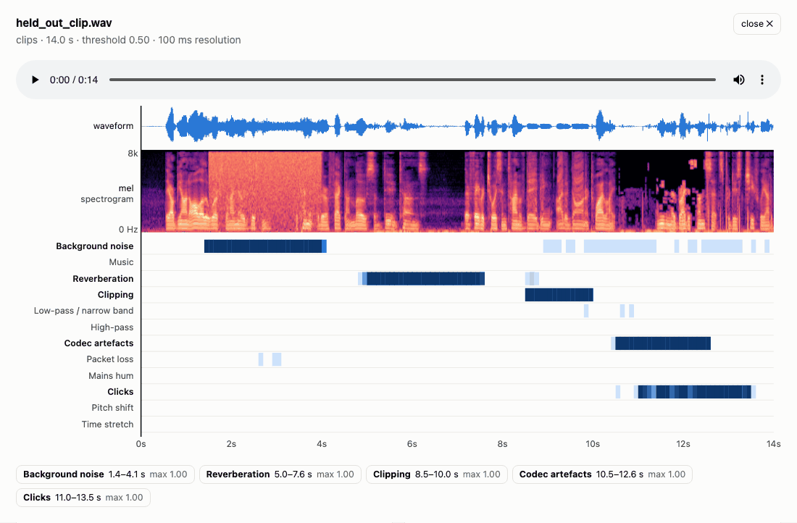
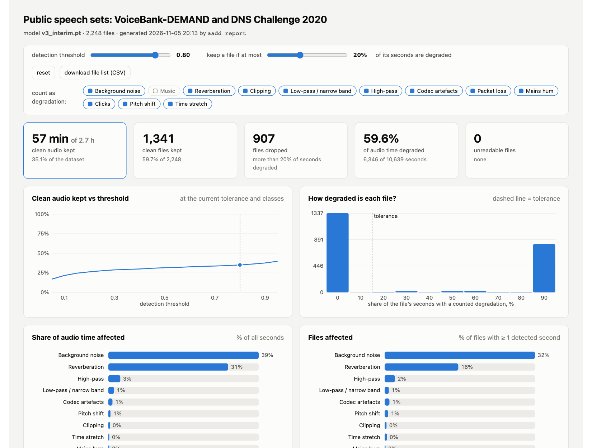
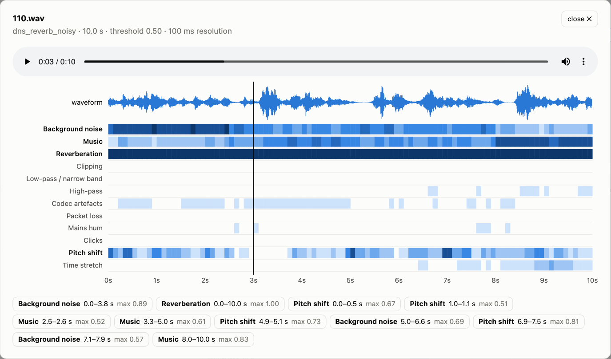

# AADD — Automatic Audio Degradation Detection

<p align="center">
  <a href="https://huggingface.co/agertel/aadd">
    <picture>
      <source media="(prefers-color-scheme: dark)" srcset="https://huggingface.co/datasets/huggingface/badges/resolve/main/model-on-hf-lg-dark.svg">
      
    </picture>
  </a>
</p>

[](https://github.com/gertelrina/aadd/actions/workflows/ci.yml)
[](LICENSE)

**Contents:** [Install](#install) · [Usage](#usage) · [Models](#models) · [Results](#results) · [v3](#v3-what-it-builds-on) · [Dataset report](#dataset-report) · [Reproducing](#reproducing--training-on-your-own-data) · [Limitations](#limitations) · [Layout](#repository-layout) · [Citation](#citation)  
**Docs:** [related work, 100 references](docs/related_work.md) · [model card](docs/model_card.md) · [v3 plan](docs/v3_plan.md)

<p align="center">
  <picture>
    <source media="(prefers-color-scheme: dark)" srcset="docs/img/demo_dark.gif">
    
  </picture>
</p>
<p align="center"><sub>This is the file view of the <a href="#dataset-report">dataset report</a>, recorded as is. The clip is held-out LibriSpeech speech with five degradations inserted at known times: noise 1.5–4.0 s, reverberation 5.0–7.5 s, clipping 8.5–10.0 s, MP3 at 8 kbit/s 10.5–12.5 s, clicks 11.0–13.5 s. v3 finds all five.</sub></p>

Per-second detection of common audio degradations in speech recordings:
**Gaussian noise, pitch shift, time stretch, clipping, low-pass and high-pass
filtering** (plus a *circular shift* class, see [Limitations](#limitations)).
Given a file or a folder, AADD tells you *which* seconds are degraded, *how*,
and how much of a dataset is affected — a quality gate for ASR / TTS training
data, podcast and call-centre pipelines.

Version 2 is an installable package with a CLI, a tested inference API, a
reproducible data pipeline and a faster model; the first model (2025) ships
unchanged as `v1`.

```
$ aadd scan examples/speech/61-70968-0000_4.flac
examples/speech/61-70968-0000_4.flac   4.0s   2/4 degraded s   ClippingDistortion 1.00, HighPassFilter 1.00
```

| | v1 (2025) | v2 (this release) |
|---|---|---|
| macro-F1, 108 936 test seconds | 0.831 | **0.919** |
| CPU time per second of audio | 133 ms | **39 ms** |

## v3: what it builds on

<details><summary>v3 plan: 12 realistic degradation classes every 20 ms, English and Russian, and the nine works it combines</summary>

v3 (see [docs/v3_plan.md](docs/v3_plan.md); weights on [Hugging Face](https://huggingface.co/agertel/aadd)) replaces the seven
`audiomentations` classes with **12 realistic degradations**, labels them **every
20 ms** instead of every second, allows **several at once**, and covers **English
and Russian**. No single paper does all of this with open weights; v3 combines the
pieces below.

| work | what v3 takes from it | why it matters |
|---|---|---|
| [URGENT Challenge](https://arxiv.org/abs/2406.04660) (Zhang et al., 2024–2026) | the degradation taxonomy: noise, reverberation, clipping, band limitation, codecs, packet loss | an agreed, realistic class list used by the speech-enhancement community, instead of augmentation-library defaults |
| [Audio Degradation Toolbox](https://archives.ismir.net/ismir2013/paper/000145.pdf) (Mauch & Ewert, ISMIR 2013) | chainable degradation units in a fixed signal-chain order; hum and click generators | reproducible compound degradations with exact ground truth |
| [DAMOS](https://arxiv.org/abs/2608.21176) (Li, Dong, Yan, 2026) | partial distortions inserted into random segments of LibriSpeech with frame-level labels | the model learns *where*, not just *whether*; no seams at fixed 1-s boundaries |
| [Speech Quality Embeddings](https://arxiv.org/abs/2605.21332) (Kuhlmann et al., Odyssey 2026) | simultaneous degradations in one clip; frame-level evaluation | real recordings rarely have exactly one problem |
| [Higham et al.](https://openaccess.thecvf.com/content/WACV2022W/VAQ/papers/Higham_A_No-Reference_Model_for_Detecting_Audio_Artifacts_Using_Pretrained_Audio_WACVW_2022_paper.pdf) (Amazon, WACV-W 2022) | a pretrained audio backbone instead of an ImageNet CNN; hum and click classes; per-second reporting | audio pre-training transfers far better to artefact detection |
| [Saishu et al.](https://link.springer.com/article/10.1186/s13636-021-00198-4) (EURASIP 2021) | one independent detector (sigmoid) per degradation type | handles co-occurring and unseen combinations, unlike a softmax |
| [WhiSQA](https://arxiv.org/abs/2508.02210) (Close et al., 2025), [UTMOSv2](https://arxiv.org/abs/2409.09305) (Baba et al., SLT 2024) | a speech foundation encoder (Whisper) as the backbone | Whisper was trained on noisy, multilingual real-world audio and is Apache-2.0 licensed |
| [Tamm et al.](https://arxiv.org/abs/2308.12077) (WASPAA 2023) | a learnable weighted sum of **all** encoder layers | noise and room cues live in early layers, which the last layer discards |
| [Hook-Net](https://arxiv.org/abs/2202.05718) (Wolff et al., ISMIR 2021) | frame-level outputs and masking frames where a defect is physically absent | clicks and clipping are sparse; per-chunk labels would be mostly wrong |

Data and models used, all openly licensed: LibriSpeech and Russian LibriSpeech
(speech), MUSAN (noise, music), RIRS_NOISES and the MIT IR survey (room impulse
responses), Whisper-small (backbone); VoiceBank-DEMAND, DNS Challenge 2020 and
Dynamic-SUPERB for out-of-domain evaluation. Details and licences:
[docs/v3_plan.md](docs/v3_plan.md); the wider literature: [docs/related_work.md](docs/related_work.md).

</details>

## Dataset report

`aadd scan DIR --report report.html` (or `aadd report scan.json`) writes one
self-contained, **interactive** HTML page for the whole dataset. Move the
detection threshold, set how many degraded seconds a file may have and still be
kept, switch classes on or off ("ignore music"), and every number updates live:
how much clean audio is left, which degradations dominate, how degraded each file
is, which problems come together, each folder, the worst files with a per-second
timeline. Click any file to **listen to it** with a waveform and a 100 ms class timeline that follows playback (click the timeline or a detected interval to jump there). One click exports the list of kept files as CSV. Light and dark themes,
no external assets.

<picture>
  <source media="(prefers-color-scheme: dark)" srcset="docs/img/report_dark.png">
  
</picture>

Example above (threshold 0.80, files kept with ≤ 20 % degraded seconds, music not counted): v3 on 2 248 public recordings it never saw —
VoiceBank-DEMAND clean and noisy twins and the DNS Challenge 2020 dev-test.
[Open the full interactive report](https://htmlpreview.github.io/?https://github.com/gertelrina/aadd/blob/main/docs/examples/report_public_sets.html).

<picture>
  <source media="(prefers-color-scheme: dark)" srcset="docs/img/report_inspector_dark.png">
  
</picture>

The example page embeds audio for the most degraded files and a few clean ones per
folder (`--audio embed`); a report built next to your data plays every file from
disk (`--audio path`, the default).

| folder | files flagged | dominant detection |
|---|---|---|
| `voicebank_clean` (studio speech) | 1 % | — |
| `voicebank_noisy` (same sentences + DEMAND noise) | 82 % | background noise, music-like babble |
| `dns_reverb_clean` (reverberant speech) | 100 % | reverberation |
| `dns_reverb_noisy` | 100 % | reverberation + noise |
| `dns_real_recordings` (real noisy calls) | 97 % | background noise |

```bash
aadd scan my_dataset/ --model v3 --report my_dataset_report.html   # v3 weights are fetched from Hugging Face once
```

## Install

```bash
pip install "aadd[app] @ git+https://github.com/gertelrina/aadd"
# or, for development / training:
git clone https://github.com/gertelrina/aadd && cd aadd
pip install -e ".[all]"
```

Requirements: Python ≥ 3.10, PyTorch ≥ 2.1 (CPU is fine; CUDA and Apple MPS
are picked up automatically), `libsndfile` for FLAC/WAV.
Model weights are hosted on Hugging Face ([agertel/aadd](https://huggingface.co/agertel/aadd)) and downloaded once to `~/.cache/aadd` on first use (v1/v2 16 MB, v3 177 MB); set `AADD_CACHE` to change the folder.

## Usage

### Command line

```bash
aadd scan path/to/audio_dir -o report.csv --segments seconds.csv   # folder -> per-file + per-second CSV
aadd scan a.flac b.wav --json out.json --threshold 0.7              # files -> JSON
aadd scan big_dir --workers 8 --model v1                            # parallel feature extraction, first model
aadd app                                                            # Streamlit UI on http://localhost:8501
aadd info                                                           # bundled models, device
```

`report.csv` has one row per file: `status` (clean / degraded / error),
`degraded_segments`, `degraded_fraction`, `aadd_count` (number of detected
(second, class) pairs), the list of `detected`
classes and the max probability per class (`p_<class>`). `seconds.csv` has one
row per second with all class probabilities. Any format `libsndfile`/`ffmpeg`
can read is accepted; audio is resampled to 16 kHz mono.

<details><summary><b>Python API</b></summary>

```python
from aadd import Detector

det = Detector("v2")                       # "v1" = first model, or a checkpoint path
res = det.predict_file("call.wav")
res.detected                               # {'AddGaussianNoise': 0.98}
res.probs                                  # (n_seconds, 8) sigmoid probabilities
res.segment_labels()                       # [['AddGaussianNoise'], [], ...]
res.degradation_count, res.degraded_fraction

for r in det.scan(["a.flac", "b.flac"], workers=4):   # many files, parallel features
    print(r.file_row())
```

</details>

<details><summary><b>Streamlit app and Docker</b></summary>

`aadd app` opens a UI with file upload, local-folder scan, bundled examples, a
per-second probability timeline for every file, dataset-level statistics and
CSV export. `docker build -t aadd . && docker run -p 8501:8501 aadd` does the
same in a container.

</details>

## Models

<details><summary>Three models: v1 (PNG input), v2 (direct log-mel), v3 (Whisper encoder, 12 realistic classes every 20 ms)</summary>

| name | input features | backbone | params | feature time / s of audio | notes |
|---|---|---|---|---|---|
| `v1` | mel spectrogram **rendered to a 310×385 PNG with matplotlib** (magma colormap, axes off) | EfficientNet-B0 (ImageNet init), 8 sigmoid outputs | 4.0 M | ≈ 9 ms | the first model (2025-03-11), unchanged weights |
| `v2` | log-mel tensor 1×128×63 (n_fft 1024, hop 256, top_db 80) | EfficientNet-B0 (ImageNet init, 1-channel stem), 8 sigmoid outputs | 4.0 M | ≈ 1 ms | same data protocol, no image rendering, SpecAugment-style masking |
| `v3` | Whisper log-mel 80 × 800 (8-s windows, sliding) | Whisper-small encoder, weighted sum of all layers, conv head, 12 sigmoids per 20 ms | 88 M | GPU / Apple MPS recommended | realistic degradations, English + Russian; [weights on Hugging Face](https://huggingface.co/agertel/aadd), downloaded on first use |

Both predict, for every 1-s chunk, the probability of each of
`AddGaussianNoise, PitchShift, TimeStretch, Shift, ClippingDistortion,
LowPassFilter, HighPassFilter, None`. The v1 pipeline rendered spectrograms
through `matplotlib` → PNG → RGB; `aadd.features.render_mel_png` reproduces it
pixel-for-pixel (tested), so `v1` keeps producing exactly its original outputs.
`v2` drops the rendering step: deterministic features, no matplotlib at
inference, 3–5× faster end to end (measured below).

</details>

## Results

### v3 (Hugging Face: [agertel/aadd](https://huggingface.co/agertel/aadd))

Real recordings it never saw in training (clip score = 95th percentile of frame
probabilities):

| set | class | ROC-AUC | recall at p ≥ 0.5 | false alarms on clean |
|---|---|---|---|---|
| VoiceBank-DEMAND test, 824 noisy + 824 clean twins | noise | 0.985 | 0.51 | 0.4 % |
| DNS Challenge 2020 synthetic dev-test, 600 clips | noise | 0.997 | 0.85 | 0.0 % |
| DNS Challenge 2020 synthetic dev-test, 600 clips | reverberation | 1.000 | 1.00 | 0.0 % |
| Dynamic-SUPERB noise detection | noise | 0.995 | 0.96 | 1.1 % |
| Dynamic-SUPERB reverberation, small / medium / large room | reverberation | 0.995 / 1.000 / 0.998 | 0.97 / 1.00 / 0.96 | 0 % |

Held-out synthetic tests with up to three overlapping degradations (all 12 classes):

| test set | frame macro-AP (20 ms) | 1-s macro-F1 | clip macro-AUC |
|---|---|---|---|
| English, LibriSpeech test-clean speakers | 0.955 | 0.915 | 0.988 |
| Russian, Russian LibriSpeech test speakers | 0.959 | 0.883 | 0.986 |
| English, real measured room impulse responses | 0.951 | 0.909 | 0.989 |

v3 also catches what the earlier models were never trained to see: the
repository's own "clean" reference clip `examples/degradations/orig.flac` turns out
to be a narrow-band phone recording (no energy above 4 kHz; v3: low-pass 1.00,
codec 0.93), and LibriSpeech utterance `61-70968-0000` carries 60 Hz mains hum
(v3: hum 1.00). Full report: [runs/eval_v3.json](runs/eval_v3.json); per-class
numbers and limitations: [model card](https://huggingface.co/agertel/aadd).

### v1 and v2 (7 synthetic classes, 1-s chunks)

Evaluation on the regenerated test set (LibriSpeech **test-clean**, 2 620
source files × (1 clean + 5 degraded copies) = 15 720 files, 108 936 seconds,
41.6 % of them degraded; per-second labels; threshold 0.5). Reports with all
numbers are in [`runs/`](runs/).

### Models at a glance

| model | input | F1 macro (8 classes) | F1 macro (7 degradations) | F1 micro | exact match per second | file-level Spearman | ms per audio second, CPU / MPS |
|---|---|---|---|---|---|---|---|
| `v1` (2025) | PNG 310×385 | 0.831 | 0.818 | 0.908 | 0.906 | 0.932 | 133 / 14.4 |
| `v2` (this release) | log-mel 1×128×63 | **0.919** | **0.916** | **0.930** | **0.927** | **0.938** | 39 / 3.1 |

<details><summary><b>Per-class F1 (threshold 0.5)</b></summary>

| class | support (seconds) | `v1` | `v2` | DSP baseline (best F1) |
|---|---|---|---|---|
| AddGaussianNoise | 6,384 | **1.000** | 0.999 | 0.999 |
| PitchShift | 6,523 | **0.934** | 0.912 | 0.113 |
| TimeStretch | 6,439 | 0.941 | **0.968** | 0.714 |
| Shift | 6,522 | 0.000 | **0.726** | 0.120 |
| ClippingDistortion | 6,417 | 0.864 | 0.818 | **0.961** |
| LowPassFilter | 6,436 | 0.991 | **0.997** | 0.924 |
| HighPassFilter | 6,606 | **0.992** | 0.992 | 0.971 |
| None | 63,609 | 0.926 | **0.942** | — |

</details>

<details><summary><b>Per-class detail</b></summary>

| class | `v1` ROC-AUC | `v2` ROC-AUC | DSP ROC-AUC | `v2` precision | `v2` recall | `v2` AP |
|---|---|---|---|---|---|---|
| AddGaussianNoise | **1.000** | 1.000 | 1.000 | 0.999 | 1.000 | 1.000 |
| PitchShift | **1.000** | 1.000 | 0.500 | 0.839 | 0.998 | 0.993 |
| TimeStretch | 0.995 | **0.996** | 0.790 | 0.989 | 0.948 | 0.984 |
| Shift | 0.605 | **0.975** | 0.510 | 0.692 | 0.763 | 0.795 |
| ClippingDistortion | **0.973** | 0.971 | 0.963 | 0.784 | 0.856 | 0.880 |
| LowPassFilter | **1.000** | 1.000 | 0.995 | 0.999 | 0.996 | 1.000 |
| HighPassFilter | **1.000** | 1.000 | 0.999 | 0.984 | 1.000 | 1.000 |
| None | 0.918 | **0.982** | — | 0.960 | 0.925 | 0.983 |

</details>

<details><summary><b>File level (15 720 files)</b></summary>

| | `v1` | `v2` |
|---|---|---|
| Spearman(true number of degraded seconds, predicted `aadd_count`) | 0.932 | 0.938 |
| Pearson | 0.941 | 0.956 |
| mean absolute error of the count, seconds | 0.552 | 0.404 |

</details>

<details><summary><b>`v2` confusion matrix (argmax over the 8 outputs; rows = true, columns = predicted)</b></summary>

| true \ pred | Noise | Pitch | Stretch | Shift | Clip | LPF | HPF | None |
|---|---|---|---|---|---|---|---|---|
| Noise | **6,382** | 0 | 0 | 0 | 1 | 0 | 0 | 1 |
| Pitch | 0 | **6,506** | 5 | 0 | 0 | 0 | 0 | 12 |
| Stretch | 0 | 121 | **6,090** | 9 | 10 | 0 | 1 | 208 |
| Shift | 0 | 65 | 5 | **5,008** | 68 | 0 | 9 | 1,367 |
| Clip | 1 | 9 | 2 | 36 | **5,496** | 0 | 0 | 873 |
| LPF | 0 | 3 | 1 | 5 | 0 | **6,409** | 0 | 18 |
| HPF | 0 | 0 | 0 | 0 | 0 | 0 | **6,606** | 0 |
| None | 3 | 972 | 47 | 2,190 | 1,475 | 8 | 94 | **58,820** |

</details>

<details><summary><b>Speed (300 test files, 2 106 s of audio, one process, Apple M3 Pro)</b></summary>

| | `v1` | `v2` | speed-up |
|---|---|---|---|
| CPU: ms per second of audio (× real time) | 132.9 (8×) | 39.4 (25×) | 3.4× |
| Apple MPS: ms per second of audio (× real time) | 14.4 (69×) | 3.1 (324×) | 4.7× |

</details>

<details><summary><b>How to read these numbers</b> (why Shift, clipping and time stretch behave as they do)</summary>

* `v2` is trained on the same protocol and data size as `v1`; the gains come from
  the direct log-mel input (finer time resolution: hop 256 vs 512), SpecAugment
  masking and proper model selection, not from more data.
* `Shift` (a circular roll of the samples inside the second) is invisible to `v1`
  (F1 0.000, which pulls its macro-F1 far below micro-F1). `v2` detects it (F1 0.73, AUC 0.98) through the seam the roll leaves in the
  waveform: a plain `np.roll` without any fade is flagged in 88 % of clean seconds.
  It is a discontinuity detector, not a "shift" detector; treat it as such.
* `ClippingDistortion` is drawn with a percentile threshold in 0–20 %; near 0 %
  it leaves the signal untouched, so part of that class is unlearnable by
  construction. The one-line DSP clipping detector beats both CNNs here.
* `TimeStretch` with rate > 1 is zero-padded back to 1 s, so part of that class
  is detected through the silent tail rather than the stretch itself.
* The DSP baselines show which classes do *not* need a neural network: noise,
  band-limiting and clipping are solved by one-line detectors; pitch shift is
  where the CNN earns its keep.

</details>

## Reproducing / training on your own data

<details><summary>Full pipeline: LibriSpeech → synthetic degradations → features → train → evaluate</summary>

```bash
scripts/reproduce.sh          # download LibriSpeech dev-clean/test-clean, build data, train v2, evaluate (≈25 min on an M3 Pro)
```

Step by step:

```bash
aadd make-data LibriSpeech/dev-clean  --out data/train --copies 5 --seed 0   # 1-s chunks, one random degradation per chunk with p=0.5
aadd make-data LibriSpeech/test-clean --out data/test  --copies 5 --seed 1
aadd featurize data/train --out feats/train_mel.npz --features mel
aadd featurize data/test  --out feats/test_mel.npz  --features mel
aadd train --train feats/train_mel.npz --test feats/test_mel.npz --out my_model.pt --epochs 10
aadd eval data/test --model my_model.pt --workers 8 --out runs/my_model_eval      # per-class table + file-level correlation
aadd eval data/test --baselines                                                # DSP baselines on the same data
aadd export-onnx --model my_model.pt --out my_model.onnx
```

`make-data` accepts any folder of clean audio (`--no-librispeech`), so the same
protocol works for your own domain. The augmentation parameters live in
`aadd/constants.py`; the dataset is fully determined by `--seed`. Validation
for model selection is a speaker-disjoint 10 % of the training set; the test
set is never used for selection.

</details>

## Limitations

<details><summary>What the models were not trained for</summary>

* The degradations are **synthetic** (audiomentations on clean LibriSpeech).
  Real-world noise, reverberation, codecs and packet loss are not classes;
  treat the output on such data as "something is off" rather than a diagnosis,
  and use `aadd eval` on your own labelled data before trusting thresholds.
* One label per second: overlapping degradations were not in the training data.
* English read speech at 16 kHz; other content types were not evaluated.
* `Shift` is a circular roll inside a second; `v1` cannot see it, `v2` reacts to
  the waveform seam it leaves. Read it as "discontinuity inside this second".

See [docs/related_work.md](docs/related_work.md) for how AADD relates to
non-intrusive quality metrics (NISQA, DNSMOS, UTMOS, SQUIM, Audiobox
Aesthetics) and to other degradation detectors.

</details>

## Repository layout

<details><summary>Directory tree</summary>

```
aadd/            package: features, model, infer (Detector), cli, app, train, eval, baselines, data/
examples/        a few 16 kHz speech files and one clean second under each degradation (flac + png)
runs/            evaluation reports (json + md) referenced in this README
docs/            related work, model card, v3 plan
tests/           pytest suite (v1 features reproduced bit-for-bit, data pipeline, CLI, app)
```

</details>

## Citation

<details><summary>BibTeX</summary>

```bibtex
@software{gertel_aadd,
  author = {Gertel, Arina},
  title  = {AADD: Automatic Audio Degradation Detection},
  url    = {https://github.com/gertelrina/aadd},
  year   = {2026}
}
```

MIT license.

</details>
